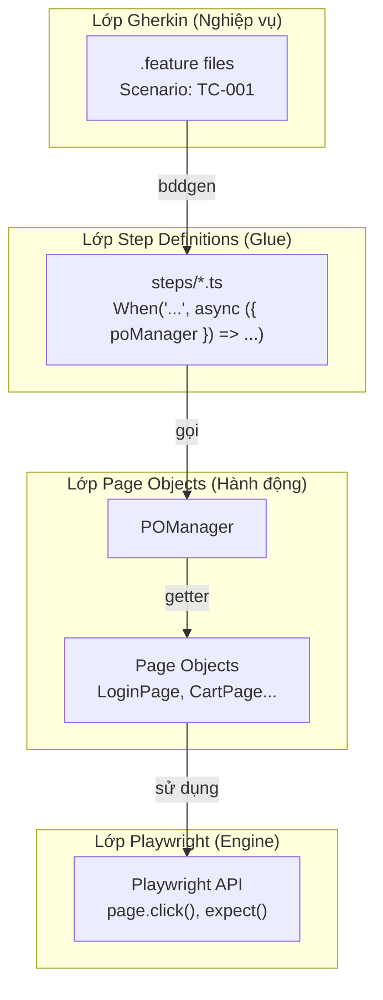
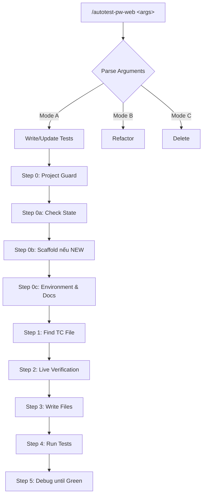
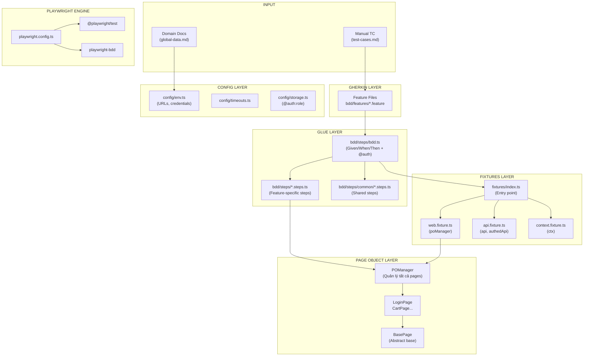
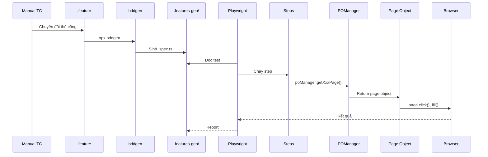
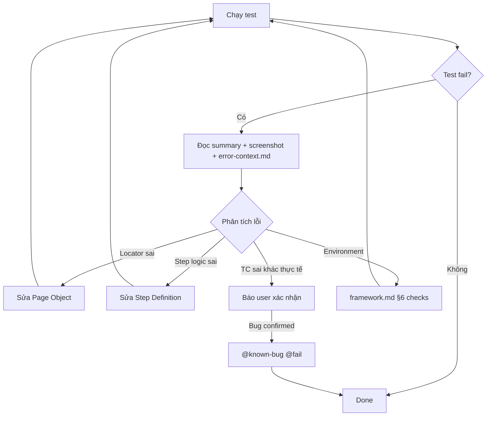

# Phân tích Skill autotest-pw-web

> **Mục đích:** Giúp Automation Tester hiểu kiến trúc, cách hoạt động và cơ chế sinh file của skill `autotest-pw-web`.

---

## TÓM TẮT ĐIỂM CHÍNH

### 1. autotest-pw-web là gì?

**autotest-pw-web** là một AI Skill hướng dẫn Claude Code viết, cập nhật, refactor và xóa test tự động cho ứng dụng Web, sử dụng:
- **Playwright** (TypeScript) làm công cụ tự động hóa trình duyệt
- **Cucumber/BDD style** (Gherkin + playwright-bdd) để viết kịch bản test dễ đọc

### 2. Ba khái niệm cần phân biệt rõ

| Khái niệm | Mô tả |
|-----------|-------|
| **AI Skill** | File `SKILL.md` + references hướng dẫn AI thực hiện công việc |
| **Automation Framework** | Cấu trúc thư mục `automation_test/` + code TypeScript được tạo ra |
| **Test Cases** | Các Scenario trong file `.feature` - kịch bản kiểm thử cụ thể |

### 3. Công nghệ chính

```
Gherkin (.feature) → playwright-bdd → Playwright Test → Trình duyệt
     ↑                    ↑                  ↑
 Ngôn ngữ tự nhiên    Chuyển đổi         Engine test
```

| Công nghệ | Vai trò |
|-----------|---------|
| **Playwright** | Điều khiển trình duyệt, chụp ảnh, quay video, trace |
| **Cucumber/Gherkin** | Viết kịch bản test bằng ngôn ngữ tự nhiên (tiếng Việt) |
| **playwright-bdd** | Cầu nối Gherkin → Playwright Test (giữ fixtures, parallelism, reporting) |
| **TypeScript** | Ngôn ngữ lập trình chính, strict type checking |

### 4. Kiến trúc tổng thể Framework



### 5. Luồng thực thi một Test Case

```
1. Viết .feature (Gherkin)
       ↓
2. npx bddgen (sinh code vào .features-gen/)
       ↓
3. npx playwright test --grep @TC-001
       ↓
4. Playwright đọc .features-gen/, chạy từng Scenario
       ↓
5. Step definitions gọi Page Objects qua POManager
       ↓
6. Page Objects gọi Playwright API (click, fill, expect...)
       ↓
7. Kết quả → results/ (HTML report, screenshot, trace)
```

### 6. Cấu trúc thư mục chính

```
automation_test/
├── bdd/
│   ├── features/           # Kịch bản Gherkin (.feature)
│   └── steps/              # Step definitions + bdd.ts
├── pages/                  # Page Object Model
│   ├── POManager.ts        # Quản lý tất cả page objects
│   └── <feature>/Page.ts   # Page object cho từng màn hình
├── fixtures/               # Playwright fixtures (DI)
│   └── index.ts            # Import duy nhất cho test
├── config/                 # Cấu hình (env, timeouts, storage)
├── services/               # API Objects (gọi API)
├── data/                   # Dữ liệu test (JSON)
├── results/                # Kết quả chạy test
└── playwright.config.ts    # Cấu hình Playwright
```

### 7. Ba chế độ hoạt động của Skill

| Mode | Trigger | Hành động |
|------|---------|-----------|
| **Mode A** | `/autotest-pw-web checkout` | Viết/cập nhật test |
| **Mode B** | `/autotest-pw-web refactor cart` | Refactor code theo best practices |
| **Mode C** | `/autotest-pw-web xoá TC-005` | Xóa test case và code không dùng |

### 8. Quy tắc quan trọng của Skill

1. **AI hành động, user chỉ cung cấp dữ liệu** - AI tự chạy mọi lệnh
2. **Manual TC là hợp đồng** - Không tự ý đổi title, bước, kết quả mong đợi
3. **Verify live trước khi viết** - Dùng Playwright MCP/CLI kiểm tra locator
4. **Chạy test sau khi viết** - Done = test PASS trên app thật
5. **Không ghi đè file** - Chỉ edit phần cần thiết

### 9. Điểm khác biệt so với cucumber-js thuần

| cucumber-js (course) | playwright-bdd (skill này) |
|---------------------|---------------------------|
| Mất Playwright fixtures | Giữ nguyên fixtures |
| Không có trace/video | Có trace, video, screenshot |
| Khó parallel | fullyParallel native |
| Tự build reporter | HTML/JUnit/Monocart sẵn |
| `this` (World) | `ctx` fixture |

---

## CHI TIẾT TỪNG PHẦN

(Xem các phần tiếp theo bên dưới)

---

# PHẦN 1: TỔNG QUAN VỀ SKILL

## 1.1 Skill autotest-pw-web giải quyết vấn đề gì?

Skill này giải quyết bài toán **tự động hóa việc viết automation test cho Web** bằng cách:

1. **Chuẩn hóa cấu trúc dự án** - Mọi dự án tuân theo cùng một layout
2. **Hướng dẫn AI viết code đúng chuẩn** - AI không tự sáng tạo, tuân theo quy tắc
3. **Đảm bảo chất lượng** - Verify live locator trước khi viết, chạy test sau khi viết
4. **Tích hợp CI/CD** - Sẵn sàng cho Jenkins, có reporter chuẩn

## 1.2 Khi nào Skill được kích hoạt?

Skill được gọi khi user nhập lệnh bắt đầu bằng `/autotest-pw-web`:

```bash
/autotest-pw-web checkout                    # Viết test cho feature checkout
/autotest-pw-web viết test cho giỏ hàng      # Cú pháp tự nhiên
/autotest-pw-web sửa TC-003 của checkout     # Cập nhật test case cụ thể
/autotest-pw-web refactor phần cart          # Refactor code
/autotest-pw-web xoá TC-005 của login        # Xóa test case
```

## 1.3 Skill cung cấp những gì?

### Workflows (Quy trình làm việc)



### References (Tài liệu tham khảo)

| File | Nội dung |
|------|----------|
| `framework.md` | Layout, naming, scaffold, conventions |
| `bdd-gherkin.md` | TC → Scenario mapping, steps, ctx, hooks, tags |
| `web-best-practices.md` | Locators, waits, assertions, components |
| `live-locator.md` | Verify locator bằng Playwright MCP/CLI |

### Templates (Mẫu code)

- `templates/core/` - Bộ khung cơ bản của framework
- `examples/` - Ví dụ đã chạy PASS (TodoMVC, Login, Upload/Download...)

### Scripts (Công cụ)

- `pw_scaffold.py` - Script Python tạo/kiểm tra cấu trúc project

---

# PHẦN 2: KIẾN TRÚC TỔNG THỂ CỦA FRAMEWORK

## 2.1 Tại sao kết hợp Playwright + Cucumber?

| Playwright Test thuần | Playwright + Cucumber (BDD) |
|-----------------------|----------------------------|
| Viết code thuần TypeScript | Viết kịch bản tiếng Việt, dễ đọc |
| Developer-centric | Business/QA-centric |
| Khó map với manual TC | 1 Scenario = 1 TC (trực quan) |
| Test title tự do | Title = TC-NNN — Title (theo chuẩn) |

**Quyết định thiết kế:** Dùng `playwright-bdd` thay vì `cucumber-js` để giữ lại:
- Playwright fixtures (page, context, request...)
- Parallel execution native
- Trace, video, screenshot
- HTML/JUnit/JSON reporters

## 2.2 Sơ đồ kiến trúc chi tiết



## 2.3 Vai trò của từng thành phần

| Thành phần | Trách nhiệm |
|------------|-------------|
| **Feature Files** | Kịch bản test bằng Gherkin (Given/When/Then) |
| **bdd.ts** | Export Given/When/Then + xử lý tag @auth |
| **Step Definitions** | Nối câu Gherkin với Page Object calls |
| **POManager** | Factory quản lý tất cả Page Objects |
| **Page Objects** | Đóng gói locators + actions của từng màn hình |
| **Fixtures** | Dependency Injection (page, poManager, ctx, api...) |
| **Config** | Cấu hình môi trường, timeouts, storage states |

---

# PHẦN 3: CÔNG NGHỆ VÀ VAI TRÒ

## 3.1 Stack công nghệ

```
┌─────────────────────────────────────────────────────────────┐
│                    Test Automation Stack                     │
├─────────────────────────────────────────────────────────────┤
│  [Gherkin]     Ngôn ngữ mô tả test case (tiếng Việt)        │
├─────────────────────────────────────────────────────────────┤
│  [playwright-bdd]  Biên dịch Gherkin → Playwright Test      │
├─────────────────────────────────────────────────────────────┤
│  [Playwright]  Engine: điều khiển browser, network, API     │
├─────────────────────────────────────────────────────────────┤
│  [TypeScript]  Ngôn ngữ lập trình (strict mode)             │
├─────────────────────────────────────────────────────────────┤
│  [Node.js]     Runtime environment (≥ v20)                  │
└─────────────────────────────────────────────────────────────┘
```

## 3.2 Chi tiết từng công nghệ

### Gherkin
- **Vai trò:** Ngôn ngữ Domain-Specific Language (DSL) cho BDD
- **Cú pháp:** Feature, Scenario, Given/When/Then/And
- **Lợi ích:** Phi kỹ thuật có thể đọc hiểu test

```gherkin
@cart
Feature: Giỏ hàng

  @TC-003 @regression @auth:webUser
  Scenario: TC-003 — Thêm sản phẩm vào giỏ
    Given người dùng đã đăng nhập
    When người dùng thêm sản phẩm "ZARA COAT 3" vào giỏ
    Then icon giỏ hàng hiển thị số lượng 1
```

### playwright-bdd
- **Vai trò:** Bridge giữa Gherkin và Playwright Test
- **Cơ chế:** `npx bddgen` sinh file `.spec.ts` vào `.features-gen/`
- **Lợi ích:** Giữ nguyên Playwright fixtures, reporters, parallel

### Playwright
- **Vai trò:** Browser automation engine
- **Tính năng:** Auto-wait, web-first assertions, trace, video
- **API:** `page.click()`, `page.fill()`, `expect(locator).toBeVisible()`

### TypeScript
- **Vai trò:** Type-safe JavaScript
- **Cấu hình:** `strict: true`, path aliases (@pages, @fixtures...)
- **Lợi ích:** Bắt lỗi compile time, IDE support tốt

---

# PHẦN 4: LUỒNG THỰC THI TEST CASE

## 4.1 Từ Manual TC đến Automated Test



## 4.2 Ví dụ cụ thể: TodoMVC

### Bước 1: Feature File (`bdd/features/todo.feature`)
```gherkin
@web @todo
Feature: TodoMVC — quản lý công việc

  @TC-001 @smoke
  Scenario: TC-001 — Thêm công việc vào danh sách
    Given mở ứng dụng TodoMVC
    When người dùng thêm công việc "Mua cà phê"
    Then danh sách có 2 công việc
```

### Bước 2: Step Definitions (`bdd/steps/todo.steps.ts`)
```typescript
import { Given, When, Then } from './bdd';

Given('mở ứng dụng TodoMVC', async ({ poManager }) => {
  await poManager.getTodoPage().open();
  await poManager.getTodoPage().expectLoaded();
});

When('người dùng thêm công việc {string}', async ({ poManager }, text: string) => {
  await poManager.getTodoPage().addTodo(text);
});

Then('danh sách có {int} công việc', async ({ poManager }, n: number) => {
  await poManager.getTodoPage().expectCount(n);
});
```

### Bước 3: Page Object (`pages/todo/TodoPage.ts`)
```typescript
export class TodoPage extends BasePage {
  protected readonly path = '/todomvc';
  private readonly newTodo: Locator = this.page.getByPlaceholder('What needs to be done?');
  private readonly items: Locator = this.page.locator('.todo-list li');

  async addTodo(text: string): Promise<void> {
    await this.newTodo.fill(text);
    await this.newTodo.press('Enter');
  }

  async expectCount(n: number): Promise<void> {
    await expect(this.items).toHaveCount(n);
  }
}
```

### Bước 4: Chạy Test
```bash
cd automation_test
npx bddgen && npx playwright test --project=web-chromium --headed --grep @todo
npm run summary
```

---

# PHẦN 5: BẢNG GIẢI THÍCH CHI TIẾT FILE/FOLDER

## 5.1 Cấu trúc Skill (`/.claude/skills/autotest-pw-web/`)

| File/Folder | Vai trò | Chức năng | Liên hệ |
|-------------|---------|-----------|---------|
| `SKILL.md` | Prompt chính | Hướng dẫn AI viết test, 3 modes (A/B/C) | AI đọc khi gọi skill |
| `references/framework.md` | Tài liệu | Layout, naming, scaffold, run conventions | SKILL.md tham chiếu |
| `references/bdd-gherkin.md` | Tài liệu | TC → Scenario, steps, ctx, hooks, tags | SKILL.md tham chiếu |
| `references/web-best-practices.md` | Tài liệu | Locators, waits, assertions, components | SKILL.md tham chiếu |
| `references/live-locator.md` | Tài liệu | Playwright MCP/CLI để verify locator | Step 2 của Mode A |
| `scripts/pw_scaffold.py` | Script | Tạo cấu trúc project (`state`, `core`, `android`, `jenkins`) | Step 0b của Mode A |
| `templates/core/` | Template | Bộ file mẫu cho framework mới | pw_scaffold.py copy |
| `examples/` | Ví dụ | Code mẫu đã chạy PASS (TodoMVC, Login...) | AI tham khảo |

## 5.2 Cấu trúc Framework (`automation_test/`)

### Thư mục BDD

| File/Folder | Vai trò | Khi nào tạo | Được sử dụng bởi |
|-------------|---------|-------------|------------------|
| `bdd/features/*.feature` | Kịch bản test | Khi viết test (Mode A) | bddgen |
| `bdd/steps/bdd.ts` | Export G/W/T + @auth | Scaffold | Mọi step file |
| `bdd/steps/<f>.steps.ts` | Step definitions | Khi viết test | bddgen → .features-gen |
| `bdd/steps/common/*.steps.ts` | Shared steps | Khi có step dùng lại | bddgen |
| `bdd/__screenshots__/` | Visual baselines | `npm run update-snapshots` | toHaveScreenshot() |

### Thư mục Pages (POM)

| File/Folder | Vai trò | Khi nào tạo | Được sử dụng bởi |
|-------------|---------|-------------|------------------|
| `pages/POManager.ts` | Factory pattern | Scaffold (có sẵn) | web.fixture.ts |
| `pages/base/BasePage.ts` | Abstract base | Scaffold | Mọi Page Object |
| `pages/<f>/<Name>Page.ts` | Page Object cụ thể | Khi viết test | Steps qua POManager |

### Thư mục Fixtures

| File/Folder | Vai trò | Khi nào tạo | Được sử dụng bởi |
|-------------|---------|-------------|------------------|
| `fixtures/index.ts` | Entry point | Scaffold (tự sinh) | Mọi step file |
| `fixtures/web.fixture.ts` | poManager fixture | Scaffold | index.ts |
| `fixtures/api.fixture.ts` | api, authedApi | Scaffold | index.ts |
| `fixtures/context.fixture.ts` | ctx (scenario state) | Scaffold | index.ts |

### Thư mục Config

| File/Folder | Vai trò | Khi nào tạo | Được sử dụng bởi |
|-------------|---------|-------------|------------------|
| `config/env.ts` | URLs, credentials | Scaffold | Toàn bộ framework |
| `config/timeouts.ts` | Timeout values | Scaffold | playwright.config.ts |
| `config/storage.ts` | storageState paths | Scaffold | bdd.ts (@auth) |

### Các file gốc

| File | Vai trò | Khi nào tạo |
|------|---------|-------------|
| `playwright.config.ts` | Cấu hình Playwright | Scaffold |
| `package.json` | Dependencies + scripts | Scaffold |
| `tsconfig.json` | TypeScript config | Scaffold |
| `.env` | Credentials (gitignored) | cred_env.py init |
| `.gitignore` | Git ignore rules | Scaffold |

---

# PHẦN 6: CƠ CHẾ AI SKILL TẠO/SỬ DỤNG FILE

## 6.1 Khi nhận yêu cầu tạo test, AI tuân theo quy tắc nào?

### Quy trình Step-by-Step (Mode A)

```
Step 0: Project Guard
  ↓ Kiểm tra không ở template repo
Step 0a: Project State
  ↓ state = NEW | EXTERNAL | PARTIAL | COMPLIANT
Step 0b: Scaffold (nếu NEW)
  ↓ pw_scaffold.py core --platforms web --base-url ...
Step 0c: Environment & Domain Docs
  ↓ Hỏi Base URL, Auth, run mode nếu chưa có
Step 1a: Find TC File
  ↓ Glob automation_test/docs/features/**/test-cases.md
Step 1b: Read TCs
  ↓ Đọc manual TCs, chọn TC cần viết
Step 1c: Reuse Scan
  ↓ npm run steps → kiểm tra step đã có
Step 1d: Special Signals
  ↓ Phát hiện OTP, Captcha, DB, Payment...
Step 2: Live Verification
  ↓ Playwright MCP/CLI verify từng locator
Step 3: Write Files
  ↓ Page Object → POManager → Steps → Feature
Step 4: Run
  ↓ npx bddgen && npx playwright test --grep @TC-xxx
Step 5: Debug until Green
  ↓ Sửa lỗi đến khi PASS
```

## 6.2 Template và Naming Convention

### Naming Convention

| Loại | Pattern | Ví dụ |
|------|---------|-------|
| Feature file | `bdd/features/<feature>.feature` | `bdd/features/cart.feature` |
| Steps file | `bdd/steps/<feature>.steps.ts` | `bdd/steps/cart.steps.ts` |
| Page Object | `pages/<feature>/<Name>Page.ts` | `pages/cart/CartPage.ts` |
| Service | `services/<feature>/<Name>Service.ts` | `services/order/OrderService.ts` |
| Test data | `data/<feature>.json` | `data/cart.json` |

### Coding Convention

- **TypeScript only** - Không có file `.js`
- **Strict mode** - Không có `any`
- **ESM exports** - Không có `module.exports`/`require`
- **Path aliases** - `@pages/`, `@fixtures/`, `@config/`...

## 6.3 Cơ chế kiểm tra file tồn tại

Script `pw_scaffold.py` kiểm tra state của project:

```python
# state = NEW | EXTERNAL | PARTIAL | COMPLIANT
def cmd_state(args):
    has_config = os.path.exists("playwright.config.ts")
    has_fixtures = os.path.exists("fixtures/index.ts")
    has_env = os.path.exists("config/env.ts")

    if has_config and has_fixtures and has_env:
        state = "COMPLIANT"  # Đủ file → không scaffold
    elif specs or features or has_config:
        state = "PARTIAL"    # Thiếu file → hỏi user
    ...
```

**Nguyên tắc:** `copy_tree()` **KHÔNG BAO GIỜ ghi đè** file đã tồn tại:
```python
if os.path.exists(target):
    report.append(f"SKIP (exists) {target}")
    continue
```

## 6.4 Workflow sửa lỗi khi test fail



---

# PHẦN 7: ĐÁNH GIÁ ƯU ĐIỂM, HẠN CHẾ

## 7.1 Ưu điểm

| Ưu điểm | Giải thích |
|---------|------------|
| **BDD/Gherkin** | Test viết bằng tiếng Việt, stakeholder đọc được |
| **playwright-bdd** | Giữ nguyên power của Playwright (fixtures, parallel, trace) |
| **Chuẩn hóa cao** | Mọi project cùng cấu trúc, dễ onboard |
| **Live verification** | Verify locator trước khi viết → giảm debug |
| **CI-ready** | Jenkins, JUnit, HTML report sẵn sàng |
| **TypeScript strict** | Bắt lỗi sớm, IDE support tốt |
| **POManager pattern** | Quản lý Page Objects tập trung, theo course |

## 7.2 Hạn chế

| Hạn chế | Giải thích |
|---------|------------|
| **Learning curve** | Cần hiểu Gherkin + Playwright + TypeScript |
| **bddgen step** | Phải chạy `npx bddgen` mỗi khi đổi .feature/steps |
| **Verbose** | Nhiều file hơn Playwright thuần |
| **Dependency on AI** | Skill thiết kế cho AI, manual khó hơn |

## 7.3 Hướng cải tiến

1. **Auto bddgen** - Watch mode tự chạy bddgen khi file thay đổi
2. **Better error messages** - Gợi ý fix cụ thể hơn khi test fail
3. **Visual testing integration** - Tích hợp Percy/Applitools
4. **API mocking UI** - Giao diện quản lý mock responses

---

# PHẦN 8: KẾT LUẬN

## 8.1 Kiến thức Automation Tester cần nắm

### Về Gherkin/BDD
- Cú pháp Feature, Scenario, Given/When/Then
- Tags và cách sử dụng (@smoke, @TC-xxx, @auth:role)
- Scenario Outline + Examples cho data-driven
- Background cho preconditions chung

### Về Playwright
- Locator strategies (getByRole, getByText, filter...)
- Web-first assertions (toBeVisible, toHaveText...)
- Fixtures (page, context, request)
- Trace, video, screenshot

### Về TypeScript
- Type annotations, interfaces
- async/await
- Path aliases

### Về Framework này
- Cấu trúc thư mục và naming convention
- POManager pattern
- ctx fixture để share state giữa steps
- Cách chạy: `npx bddgen && npx playwright test`

## 8.2 Checklist khi bắt đầu

- [ ] Đọc `SKILL.md` để hiểu workflow
- [ ] Xem `examples/` để thấy code mẫu
- [ ] Chạy thử TodoMVC example
- [ ] Đọc `framework.md` để hiểu conventions
- [ ] Đọc `bdd-gherkin.md` để viết Gherkin đúng chuẩn
- [ ] Đọc `web-best-practices.md` để viết locator tốt

## 8.3 Tóm tắt một câu

> **autotest-pw-web** là AI Skill hướng dẫn Claude Code viết Web automation test theo Cucumber/BDD style, sử dụng Playwright + playwright-bdd + TypeScript, với cấu trúc chuẩn hóa cao và quy trình verify live trước khi viết code.

---

*Báo cáo được tạo dựa trên phân tích source code thực tế tại:*
`/Users/hieunv67/auto/demo_playwright_web/.claude/skills/autotest-pw-web/`
